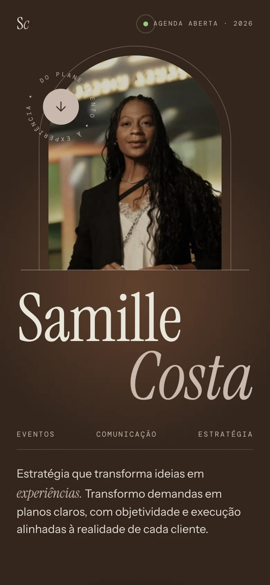
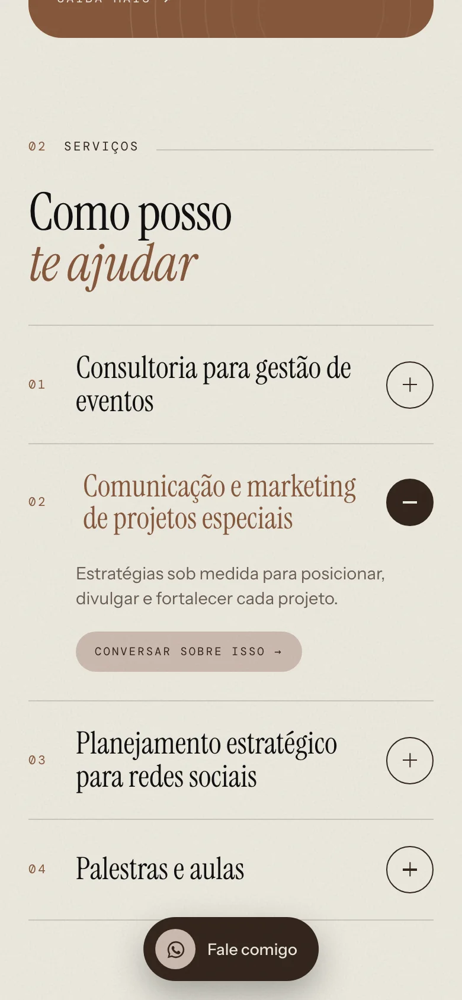
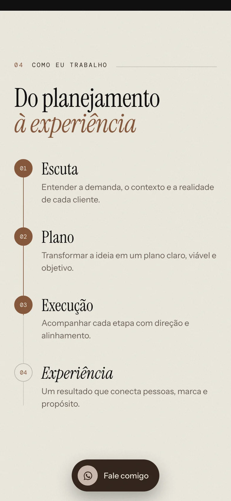
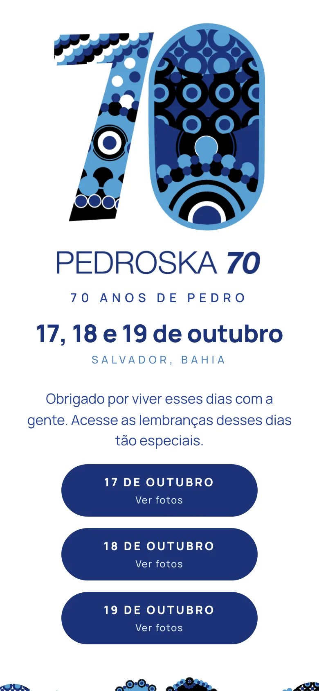
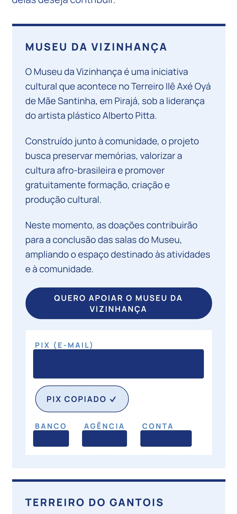
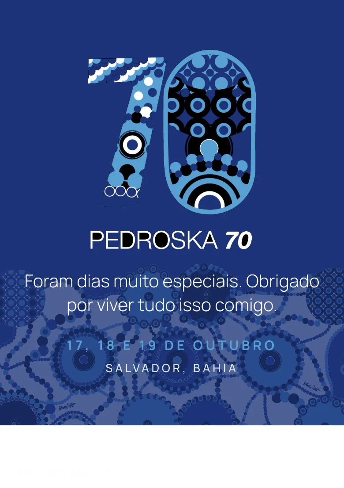
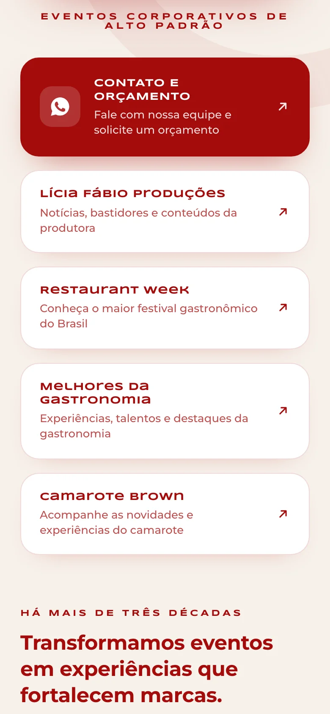
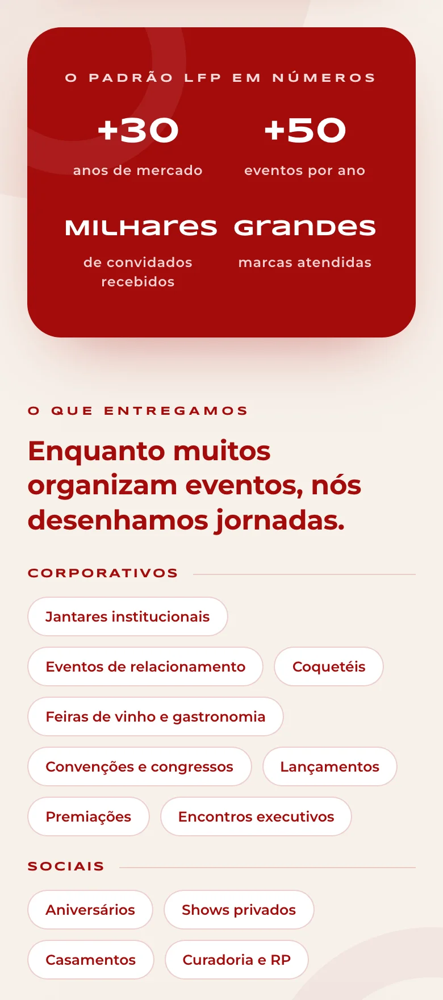
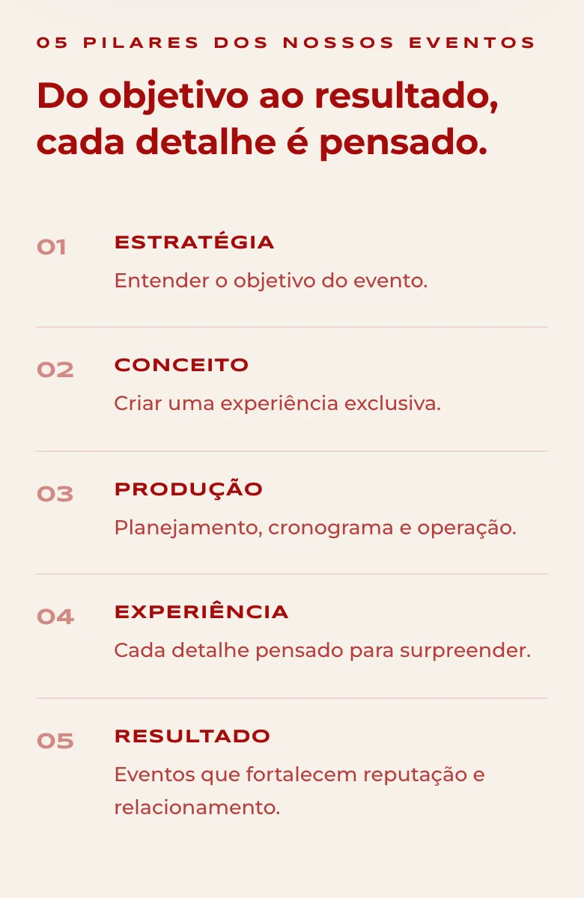

# Mobile-first Experiences

**Three brands. Three purposes. One mobile-first approach.**

A collection of three mobile-first web experiences, each built for a different communication goal: presenting a personal brand, hosting a private celebration, and routing visitors from a social-media bio to the right next step.

[](https://portfolio-marcuscastrodev.vercel.app/en?project=mobile-first-experiences&tab=overview)

> **Source code:** the three pages were delivered as standalone HTML files to private clients. Their source is **not published** in this repository. This repo documents the work with screenshots and design notes only.

---

## The collection

| | Experience | Purpose | Main action |
| :-- | :-- | :-- | :-- |
| 1 | **Samille Costa** — Personal brand experience | Present a consultant in events, communication and strategy | Start a WhatsApp conversation about a specific service |
| 2 | **PEDROSKA 70** — Digital celebration experience | Thank the guests of a three-day 70th-birthday celebration in Salvador | Open the photo album of each day; optionally support two local initiatives |
| 3 | **Lícia Fábio** — Mobile link hub | Route visitors of an events production company | Request a quote; reach the company website and three event brands |

---

## Role

Experience concept, visual direction, interface structure and front-end development of three mobile-first web experiences, using development tools and AI assistance throughout the process.

---

## 1 · Samille Costa — Personal brand experience

<p>
  
  
  
</p>

**Context.** A personal page for a consultant in event management, special-project communication, social-media planning, talks and classes, designed to be opened from an Instagram bio.

**Design decisions**

- **Hierarchy follows the goal.** The hero ends in a WhatsApp call to action. Once it leaves the screen, a floating “Fale comigo” button appears, and it hides again near the closing call.
- **Context-specific conversations.** Each service sits in a native `<details>` accordion, and each opens WhatsApp with a prefilled message naming that service.
- **Identity on a small screen.** Instrument Serif for the name (italic surname), DM Mono for labels, Instrument Sans for reading text, and an earthy palette.
- **Motion with an off switch.** The name appears letter by letter, sections reveal on scroll (IntersectionObserver), figures count up (requestAnimationFrame), and the method timeline fills while scrolling. `prefers-reduced-motion` turns all of it off.
- **One column.** The page is a single 480 px column, centred on larger screens.

---

## 2 · PEDROSKA 70 — Digital celebration experience

<p>
  
  
  
</p>

**Context.** A thank-you page for the guests of a private 70th-birthday celebration held over three days in Salvador, Bahia.

**Design decisions**

- **Memories first.** One button per day (17, 18 and 19 October) sits right below the dates and opens that day’s photo album.
- **Giving as an option, not a pitch.** Two Salvador initiatives are presented as cards with their story. Payment details stay folded behind buttons with `aria-expanded`; a “Copiar PIX” button uses the Clipboard API (with a fallback) and confirms “PIX copiado ✓” for about two seconds.
- **Brand pattern as the visual system.** The blue patterned mark frames the opening and closing; Manrope carries the text and Playfair Display italics the story.
- **Motion and access.** Sections reveal with scroll-driven CSS animations (`animation-timeline: view()`), the pattern floats slowly, type scales with `clamp()`, focus is always visible, buttons are at least 44 px tall, and `prefers-reduced-motion` is respected.
- **Self-contained delivery.** Fonts and images are embedded in a single HTML file.

> **Privacy.** In the screenshots, the PIX key, bank, branch and account values are covered by opaque bars. The private photo-album links and the embedded video are not shown.

---

## 3 · Lícia Fábio — Mobile link hub

<p>
  
  
  
</p>

**Context.** A mobile link page for an events production company based in Salvador, Bahia.

**Design decisions**

- **The conversion path is unmistakable.** The quote request is the only filled card, above the company website and three event brands, and it is repeated as the last action.
- **More than links.** Short sections add the company’s figures, its corporate and social event types as chips, its five event pillars and a founder quote, so visitors can qualify themselves before asking for a quote.
- **Brand voice.** The brand red with Syncopate uppercase labels and Montserrat for reading text; short entrance animations.
- **One column.** A single 520 px column, centred on larger screens.

> **Note.** The page file references a logo and three photos that are not part of this documentation, so only the sections that render without them are shown.

---

## Technologies (verified in the delivered files)

- **Structure & style:** HTML, CSS, CSS custom properties, CSS keyframe and scroll-driven animations, fluid type with `clamp()`, inline SVG, Google Fonts
- **Interaction:** JavaScript, IntersectionObserver, requestAnimationFrame, native `<details>` accordion, disclosure buttons with `aria-expanded`, Clipboard API with fallback
- **Delivery:** standalone HTML files, embedded fonts and images (PEDROSKA 70), WhatsApp links with prefilled messages, Vimeo embed, `prefers-reduced-motion`

## What is not claimed

No traffic, engagement or conversion figures are presented. The screenshots were rendered from the delivered files in a 390 × 844 px viewport; they are not mock-ups.

## Repository contents

```
README.md
screenshots/   14 WebP captures (6 Samille Costa · 4 PEDROSKA 70 · 4 Lícia Fábio)
```

---

**Marcus Castro** · Web & full-stack developer · [Portfolio](https://portfolio-marcuscastrodev.vercel.app) · [GitHub](https://github.com/marcuscastrodev)
